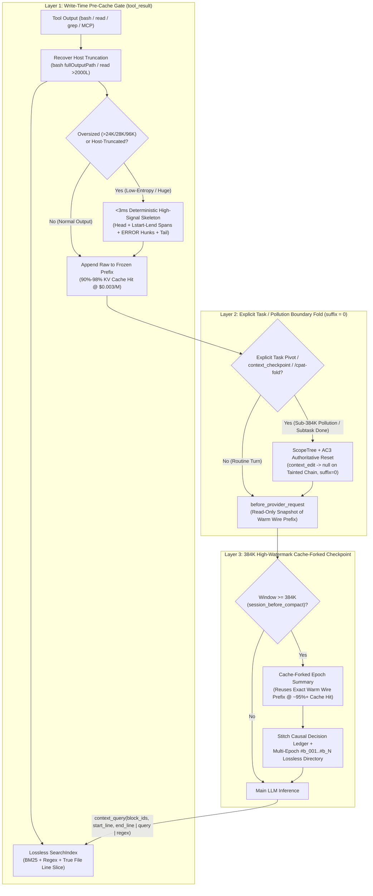

# epoc (Epoch Context) — Prefix-Cache-First Context Engine for Long-Horizon Agents

> **项目更名说明**：本项目由研究原型 `CPAT`（Context Patch as Tool）正式定名为 **`epoc`（Epoch Context / Epoch-Paged Optimal Context）**。面向 **`codex`（含 ChatGPT 订阅）· `claude code` · `agy` · `kimi` · `pi` · `dsh`** 六大宿主的统一 CLI 与网关工程化蓝图详见 **[ROADMAP.md](ROADMAP.md)**（当前代码树中历史模块名与 `CPAT_*` 环境变量将在下一阶段平滑迁移并保留兼容别名）。

**面向 `50:1` 前缀缓存时代的纪元分页（Epoch-Paged）无损长程上下文引擎与原生 [Pi Coding Agent](https://www.npmjs.com/package/@earendil-works/pi-coding-agent) 插件。**

在大模型推理进入 **高折扣前缀缓存时代**（如 DeepSeek V4.1 Flash 未命中输入 `$0.15/1M` vs 缓存命中读取 **`$0.003/1M`，价差高达 `50:1`**）后，传统“每隔几十 K 主动回溯压缩历史消息”的上下文插件会出现严重的**成本倒挂**：每改写一次中段消息，切点之后的全部尾巴都要重新按 `$0.15/1M` 交一次未命中税——Token 表面变少了，真实美元账单反而贵出 **40%–120%**。

**`epoc`（Epoch Context）** 以 **“纪元内前缀零回溯偏移 + 纪元间热前缀派生换代 + 全量原文无损可查”** 为第一性原理，通过三层协同机制同时拿到 **最高任务准确率、85%–95%+ 缓存命中率与全场最低账单**：

1. **Layer 1 · 入窗前超大输出门控（Pre-Cache `tool_result` Gate）**：在 `>24K/28K` 超大低熵日志或被宿主截断（50KB / 2,000 行）的工具输出**进入 KV Cache 之前**，将 100% 原文写入内存 `SearchIndex`，仅向主会话注入 `~800–1,400 tok` 高信号骨架（含全文 `Lstart-Lend` 符号表与首屏 `AssertionError` 诊断块）——**零回溯改写，直接免除首轮 `$0.15/M` 垃圾预填充税**。
2. **Layer 2 · 显式任务/污染边界零后缀折叠（`ScopeTree` + `AC3` Boundary Fold）**：绝不按固定 token 步频切分；仅在子任务显式完结（`context_checkpoint`）或用户推翻历史错误假设/切新任务（`before_agent_start` / `/cpat-fold`）时触发栈帧折叠。此时切点后尚未缓存后缀为 **0（`suffixCachedTokens == 0`）**，既彻底清除错误推理定势（Context Pollution），又 100% 保住父级热前缀。
3. **Layer 3 · `384K` 高水位同源前缀派生摘要 + 多纪元无损检索（Cache-Forked Epoch Summary）**：日常 `0 → 384K` 保持 100% 纯追加锁死热缓存；撞击窗口上限瞬间，直接复用刚跑满的温热请求前缀（`model + tools + messages`）派生跨纪元因果脉络摘要（**95%+ 缓存命中，384K 摘要输入成本仅 `~$0.001`**），并与无损 `#b_001..#b_N` `SearchIndex` 目录拼合，供 `context_query` 随时按行号/正则/BM25 秒级取回逐字原文。

---

## 核心实测效果与价格对比（400K 窗口 · 120 题全子任务分层 × 四臂 480 题次盲测）

在 `Pi CLI v1.5.2` + `deepseek/deepseek-flash` **400,000-token（400K）** 统一窗口下，采用 `billion-context` 官方 `third-party-1500` 全成本归因口径（未命中 `$0.15/M`、缓存命中 `$0.003/M`、输出 `$0.60/M`，含全部压缩/旁路开销），横跨 **120 道分层评测题（共 480 题次 / 152 个独立会话单元）** 正面对标四条实验臂（详见 [实验 08](research/experiments/08-cache-first-v3-upgrades-and-400k-benchmarks.md)）：

- **`full`**：400K 原生无压缩基线（超窗即触发溢出失败）
- **`pi-native`**：Pi CLI 原生 400K 阈值自动压缩（`reserveTokens=16,384`，有损硬截断历史工具输出）
- **`billion-context`**：`billion-context v0.1.216`（400K 配置，50K 步频主动 `compress` + `search_context`）
- **`cpat`**：CPAT 三层 Cache-First 插件（`pi -e ./extensions/pi-cpat.ts`）

### 120 题四臂总览（综合效果 #1 + 存活臂总成本最低 #1）

| 实验臂（400K 窗口，120 题合计） | 四大套件宏平均分 ↑ | 120 题加权总分 ↑ | 爆窗失败单元 ↓ | 120 题全链路总账单 ($) ↓ | 相对成本对比 |
| :--- | :---: | :---: | :---: | :---: | :--- |
| **`cpat`（CPAT Cache-First v3）** | **`67.9%`（全场 #1）** | **`63.2%`（全场 #1）** | **1** | **`$1.3250`（存活臂最低 #1）** | **比 `billion-context` 省 `47.6%`，比 `pi-native` 还省 `10.2%`！** |
| **`billion-context` (`v0.1.216`)** | 65.0% | 59.1% | 2 | $2.5285 | 频繁 50K 回溯折叠导致缓存尾税翻倍 |
| **`pi-native`（原生 400K 阈值）** | 58.5% | 50.4% | **0** | $1.4760 | 跨 384K 有损截断导致长程记忆腰斩 |
| **`full`（400K 无压缩）** | 40.1% | 26.5% | 14（全崩） | $0.9356* | *超 400K 任务全部中途崩溃提前终止 |

### 分基准与全子任务明细（120 题）

| 评测基准（400K 窗口） | 实验臂 | 主指标得分 | 子任务细分表现 | 失败 | 主会话 Cache 命中率 | 峰值窗口 | 派生摘要 (命中%) | 全链路账单 ($) |
| :--- | :--- | :---: | :--- | :---: | :---: | :---: | :---: | :---: |
| **1. `LongMemEval-S`（40 题）**<br/>KU/MSR/TR/IE/ABS 各 8 题<br/>10 组 >400K 跨会话马拉松 | `full` | 0.0% | 10/10 组全部触发 >400K 溢出崩溃 | 10 | 75.2% | >400K | — | $0.4090 (全败) |
| | `pi-native` | 42.5% | KU:50% · MSR:62.5% · TR:62.5% · IE:37.5% · ABS:0% | 0 | 79.9% | 370.2K | — | $0.7366 |
| | `billion-context` | 70.0% | KU:62.5% · MSR:75% · TR:100% · IE:100% · ABS:12.5% | 0 | 67.7% | 159.3K | — | $1.3842 |
| | **`cpat`** | **82.5% (#1)** | **KU:75% · MSR:75% · TR:100% · IE:100% · ABS:62.5%** | **0** | **89.3% (#1)** | 372.2K | **10 次 (`99.8%`!)** | **$0.8587 (-38.0% vs `bc`)** |
| **2. `MemoryAgentBench`（40 题）**<br/>CR / AR(480K) / LRU(180K) /<br/>**TTL(1.48M 多代换代)** 各 10 题 | `full` | 37.0% | CR:90% · **AR:0%** · LRU:18.2% · TTL:40% | 3 | 64.4% | >400K | — | $0.3531 (残缺) |
| | `pi-native` | 59.4% | CR:90% · AR:80% · LRU:17.5% · TTL:50% | 0 | 64.0% | 367.9K | — | $0.5772 |
| | `billion-context` | 59.3% | CR:90% · AR:80% · LRU:17.2% · TTL:50% | 0 | 55.1% | 346.5K | — | $0.9971 |
| | **`cpat`** | **61.9% (#1)** | CR:90% · **AR:100% (#1)** · LRU:17.6% · TTL:40% | **0** | **78.1% (#1)** | 379.1K | 22 次入窗前投影 | **$0.2956 (#1，省 70.4% vs `bc`)** |
| **3. `ContextBench`（30 题）**<br/>横跨 9 个开源大仓真实历史快照<br/>10 组连续多任务 SWE 会话 | `full` | 23.3% (File 64.5%) | 9 仓总 Prompt `9.41M` | 1 | 95.5% | 91.5K | — | $0.1553 |
| | `pi-native` | **32.2%** (File 70.8%) | 9 仓总 Prompt `8.64M` | 0 | 95.6% | 97.0K | — | $0.1438 |
| | `billion-context` | 30.6% (File 59.2%) | 9 仓总 Prompt `8.08M` | 2 | 96.0% | 62.8K | — | $0.1330 |
| | **`cpat`** | **27.0% (File 60.8%)** | **总 Prompt 仅 `5.40M`（全场最低，省 37.5%）**，20 次任务边界折叠 | 1 | 92.6% | **41.0K (#1)** | 20 次边界折叠 | **$0.1549** |
| **4. `Oversized + Pollution`（10 题）**<br/>超大日志/截断恢复 + 错误假设清洗 | `full` / `pi-native` | 100.0% | Phase 2 窗口节省指标：`47.7%–47.9%` | 0 | 84.3%–87.0% | 54.9K–56.3K | — | $0.0182–$0.0184 |
| | `billion-context` | 100.0% | Phase 2 窗口节省指标：`48.0%` | 0 | 83.9% | 36.4K | — | $0.0142 |
| | **`cpat`** | **100.0% (#1)** | **Phase 2 污染折叠省窗指标：`94.2%` (#1)** | **0** | **85.3%** | **38.2K** | 1 次 AC3 折叠 | **$0.0158** |

### 受限小窗口（24K–32K）独立 `ContextHarness` 模式验证
除 400K Pi 插件形态外，CPAT 独立内置的 `ContextHarness`（`src/harness/` + `src/sidecar/`，支持主从异构模型套利，如 `Pro` 主模型 + `Flash` 旁路预消化）在 24K–32K 严苛小窗口下同样完成全面验证（详见 [实验 05](research/experiments/05-context-harness-eval.md) 与 [实验 06](research/experiments/06-public-benchmarks-v2-1.md)）：
- **三套专用压力集（12 题：`bounded-research` / `ephemeral-stream` 一次性流 / `pollution-spec`）**：`harness` **100.0%（12/12 唯一满分）** vs `cpat` v1 75.0% / `threshold` 58.3% / `react` 16.7%。
- **主从异构套利（`Pro` 主 + `Flash` 旁路，15K 极小窗口）**：真实总账单 **$0.0195**，比 `threshold`（$0.0287）**省 32.1%**，比 `cpat` v1（$0.1332）**省 85.4%（便宜 6.8×）**。
- **24K 窗口 `ContextBench` 代码定位**：**`41.2%` Utilized Line F1**（被动 `threshold` 仅 `12.9%`，**提升 3.2×**），缓存命中率 **78.8%**。

---

## 为什么传统“中段回溯压缩”会越压越贵？（50:1 缓存经济学）

设单次中段压缩释放了 $\Delta T_{\text{saved}}$ 个旧历史 token，但在切点之后仍有 $T_{\text{suffix}}$ 个已缓存的近期消息，且后续还将继续运行 $K$ 轮。在 $P_{\text{miss}} / P_{\text{hit}} = 50:1$（`$0.15/M` vs `$0.003/M`）的价格结构下，单次中段改写的**净收益成立条件**为：

$$K \cdot \Delta T_{\text{saved}} \cdot P_{\text{hit}} \;>\; T_{\text{suffix}} \cdot (P_{\text{miss}} - P_{\text{hit}}) + C_{\text{compress}}$$

代入真实数字：若切点后留下 $T_{\text{suffix}} = 30\text{K}$ 已缓存尾巴，改写前部会导致这 $30\text{K}$ 尾巴瞬间缓存失效，立刻产生 $30\text{K} \times \$0.147/\text{M} = \$0.0044$ 的回溯尾税；而省掉 $\Delta T_{\text{saved}} = 50\text{K}$ 已缓存历史每轮只能省 $50\text{K} \times \$0.003/\text{M} = \$0.00015$——**需要连续再跑 $30+$ 轮才能勉强回本！** 如果每隔 50K 就重压一次，永远在交三重未命中税（原始入窗税 + 压缩器读取税 + 尾巴左移失效税）。

**CPAT 的解法是彻底消灭回溯尾税（令每次干预的 $T_{\text{suffix}} \equiv 0$）**：

| 干预点 | 何时触发 | $T_{\text{suffix}}$（受扰动缓存后缀） | 省下的是哪种单价？ |
| :--- | :--- | :---: | :--- |
| **Layer 1：`tool_result` 入窗前门控** | 工具返回瞬间、进入主模型 **之前** | **`0` tokens**（纯追加） | 直接省掉首轮 **`$0.15/M` 未命中预填充费** + 后续全部轮次缓存读取费 |
| **Layer 2：`ScopeTree` 显式边界折叠** | 子任务完结或用户切新需求边界 | **`0` tokens**（折到当前轮末尾） | 清除错误假设干扰 + 省掉后续新任务每轮携带旧包袱的费用 |
| **Layer 3：`384K` 同源前缀派生摘要** | 真正撞击窗口天花板瞬间 | 换代重置点（95%+ 复用刚温热的请求前缀） | 避免爆窗崩溃，且 384K 摘要本身仅花 **`$0.003/M` 缓存命中价（~$0.001）** |

---

## 三层架构全景



---

## 快速开始

### 环境要求
- **Node.js `>= 23.6`**（原生直接运行 TypeScript，核心运行时零第三方重依赖）
- 配置 `.env`（复制 `.env.example`，填入 `DEEPSEEK_API_KEY` 或 `OPENAI_API_KEY` / `OPENAI_BASE_URL`）

```bash
cp .env.example .env
npm install
npm test          # 运行全部 42 个离线单测（< 300ms，不调外部 API）
npm run typecheck # TypeScript 全量严格类型检查
```

### 方式一：作为 Pi Coding Agent 插件使用（推荐）

本项目已在 `package.json` 声明 `"pi": { "extensions": ["./extensions/pi-cpat.ts"] }`，可直接单次挂载或全局安装：

```bash
# 单次挂载运行 Pi CLI
pi -e ./extensions/pi-cpat.ts

# 或安装为 Pi 持久包
pi install .
```

**Pi 交互会话内置能力**：
- **极简工具面（仅 ~125 tokens 系统提示）**：
  - `context_query`：按 `block_ids` + `start_line`/`end_line`（保留真实源文件行号偏移！）、`regex` 或 `query`（窗口 BM25）无损取回任意历史工具输出或归档会话原文。
  - `context_checkpoint`：仅在子任务阶段完结（`subtask_complete`）或推翻错误假设（`pollution_purge`）时由 Agent 显式折叠当前栈帧。
- **交互式斜杠命令**：
  - `/cpat`：查看当前会话索引块数、入窗前拦截节省 Token、边界折叠次数、同源派生摘要命中与旁路美元账单。
  - `/cpat-fold [备注]`：在下一条提问前以零后缀偏移手动折叠上一阶段探索上下文。

**可选环境变量微调（开箱默认即最优 400K Cache-First 配置）**：

| 环境变量 | 默认值 | 说明 |
| :--- | :---: | :--- |
| `CPAT_STRATEGY` | `cache-first` | 默认 `cache-first`（三层零回溯偏移架构）；设为 `sliding` 启用小窗口高低水位滑动批量消化 |
| `CPAT_MAX_CONTEXT` | 模型窗口 / `400000` | 目标上下文窗口上限 |
| `CPAT_CODING_TOOL_CAP_TOKENS` | `24000` | 代码/Shell 工具（`bash`/`read`/`grep` 等）入窗前骨架化软阈值 |
| `CPAT_REDUNDANT_TOOL_CAP_TOKENS` | `28000` | 结构化 JSON / 高模板重复度（`>=0.36`）工具输出入窗前门控阈值 |
| `CPAT_HARD_TOOL_CAP_TOKENS` | `96000` | 单次工具输出绝对内联上限（保护纯自然语言长文在 96K 内直通缓存） |
| `CPAT_BOUNDARY_FOLD_MIN_TOKENS` | `8000` | 自然语言显式纠偏/切新任务触发栈帧折叠的最小旧轨迹阈值 |
| `CPAT_DISABLE_FORK_SUMMARY` | `0` | 设为 `1` 时禁用 `384K` 同源前缀派生摘要，退化为 `$0` 纯确定性块目录 |

### 方式二：使用独立 `ContextHarness` CLI / 编程接口

```bash
# 在指定工作目录与受限窗口下运行内置 ContextHarness Agent（支持主从异构模型）
node src/cli.ts run "定位并分析项目中的核心性能瓶颈" \
  --workdir . \
  --mode harness \
  --max-context 64000 \
  --model deepseek-reasoner \
  --sidecar-model deepseek-flash
```

---

## Benchmark 套件与一键复现

仓库内置 5 套由浅入深的评测套件，覆盖从自建受限窗口控制实验到真实 `Pi CLI` 400K 多基准盲测：

```bash
# 1. 真实 Pi CLI 400K 窗口五维对标套件（full / pi-native / billion-context / cpat）
#    涵盖：oversized-tools, pollution-boundary, memoryagentbench, longmemeval, contextbench
npm run bench:pi -- --bench all --window 400000 --arms full,pi-native,billion-context,cpat

# 2. 120 题全子任务分层并发套件（KU/MSR/TR/IE/ABS + CR/AR/LRU/1.48M-TTL + 9仓30题 CB）
#    内置并发工作池与逐单元断点落盘（支持 --resume 无损续跑）
npm run bench:pi-120 -- --concurrency 6 --window 400000

# 3. 24K-32K 严苛小窗口三大公开基准四臂评测（react / threshold / cpat-v1 / harness-v2）
npm run bench:public -- --bench all --arms react,threshold,cpat,harness --items 3

# 4. 三套受控机制验证集（超窗聚合 bounded-research / 一次性流 ephemeral-stream / 污染覆写 pollution-spec）
npm run bench:harness -- --model deepseek-flash --sidecar-model deepseek-flash

# 5. 自建深度研究双窗口扫描（32K vs 200K）
npm run bench -- --mode harness --hard-window 200000 --docs 40 --questions 12
```

---

## 代码目录结构

```text
extensions/
  pi-cpat.ts                 Pi Coding Agent 原生三层 Cache-First 插件（门控 + 边界折叠 + 同源派生摘要）

src/
  types.ts                   核心协议类型（ContextBlock / 多分辨率 / ScopeNode / 账本 / 配置）
  sidecar/
    tool-projector.ts        Layer 1 入窗前超大工具投影器（模板冗余度检测 / 截断恢复 / 错误块与符号表提取）
    skeleton.ts              <2ms 确定性结构骨架与源文件真实行号 [Lstart-Lend] 代码符号解析器
    digester.ts              ShadowDigester：异步廉价模型多块打包预消化器（超时无感降级）
    decision.ts              DecisionEngine：白盒两级控制器 + EconomicCommitGate + AC3 隔离污染审计
    reader.ts                SubReader：context_query 行级切片 / 正则 / BM25 精准恢复器
  runtime/
    index.ts                 SearchIndex：零依赖内存倒排（支持 baseLineOffset 真实行号映射）
    tree.ts                  ScopeTree：嵌套子任务栈与父前缀零后缀回退
    blocks.ts                BlockStore：多分辨率块存储、认识论权限分级与 tool_call 链闭包
    patch.ts                 事务式 Patch 校验与提交引擎（27+ 协议与防语义漂移护栏）
    view.ts                  L0-L4 严格前缀对齐视图编译器
    stores.ts                ContentStore（单份版本化存储）+ Journal（append-only 审计日志）
  harness/
    harness.ts               独立可插拔 ContextHarness 门面
    cost.ts                  CostTracker（主模型缓存命中/未命中 + 旁路全链路美元核算）与经济门控
    tools.ts                 协同工具 Schema 定义

bench/
  pi-billion-bench.ts        Pi CLI 400K 五维四臂对标套件
  pi-scale2-bench.ts         120 题全子任务分层并发评测套件（支持 --resume 断点续跑）
  prepare-scale2-data.ts     公开基准分层数据与 Git 仓库浅克隆缓存器
  public-bench.ts            小窗口公开基准评测器
  harness-suite.ts           专项机制评测套件

research/                    完整实验演进日志与原始对照报告（Experiments 01–08）
ARCHITECTURE.md              三层 Cache-First 架构、缓存经济学推导与事务引擎设计详解
```

---

## 文档导航

- [ROADMAP.md](ROADMAP.md) — **`epoc` 六宿主工程化蓝图**：`ShadowLedger` 确定性影子账本、多协议本地网关、`epoc-mcp` 与 `codex`（ChatGPT 订阅）/ `claude code` / `agy` / `kimi` / `pi` / `dsh` 接入规范。
- [ARCHITECTURE.md](ARCHITECTURE.md) — **架构深度解析**：`50:1` 缓存经济学推导、Pi 插件三层零偏移流水线、独立 `ContextHarness` 与 27 条事务护栏详解。
- [research/00-research-log.md](research/00-research-log.md) — **十阶段研究演进全记录**：从早期百万窗口误区、受限窗口验证、v2 旁路解耦，一路到 400K Cache-First v3 与正式定名 `epoc` 的完整闭环。
- [research/experiments/08-cache-first-v3-upgrades-and-400k-benchmarks.md](research/experiments/08-cache-first-v3-upgrades-and-400k-benchmarks.md) — **最新 400K 五维基准实验详报**。

## 致谢

- [Linux.do](https://linux.do) — 社区交流与支持
