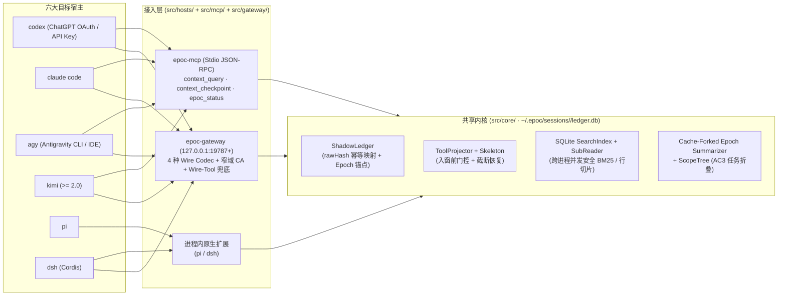

# epoc (Epoch Context) — 多客户端工程化与六宿主接入规划

> **状态**：架构与接缝已核实定稿，待按阶段实施（Pre-Implementation Blueprint）  
> **前身**：`CPAT`（Context Patch as Tool）研究原型，现正式定名为 **`epoc`（Epoch Context / Epoch-Paged Optimal Context）**  
> **首批目标宿主**：**`codex`（含 ChatGPT 订阅 OAuth）** · **`claude code`** · **`agy`（Antigravity）** · **`kimi`** · **`pi`** · **`dsh`**

---

## 1. 为什么从 `CPAT` 更名为 `epoc`？

本项目早期名称 `CPAT`（Context Patch as Tool）源于最初的研究假设：让大模型像调用普通工具一样每隔若干轮对历史上下文“打补丁（Patch）”压缩。

经过十个阶段的对照实验与 **400K 窗口 × 120 题（480 题次）真机盲测**（详见 `research/experiments/08-cache-first-v3-upgrades-and-400k-benchmarks.md`），我们用实证数据推翻了“中途打补丁”路线：
- 在现代大模型 **`50:1` 前缀缓存折价**（未命中 `$0.15/M` vs 缓存命中 `$0.003/M`）下，任何在中段改写旧消息的 Patch / Compress 工具都会击穿切点之后的后缀 KV Cache，导致真实美元账单反增 **40%–120%**。
- 最终夺得 **综合准确率全场 #1（`67.9%`）且总账单全场最低 #1（比 `billion-context` 省 `47.6%`，比 `pi-native` 省 `10.2%`）** 的架构，核心恰恰是**彻底消灭中途 Patch，改为按「纪元（Epoch）」分页单调追加**：
  1. **纪元内（Intra-Epoch）**：超大/低熵工具输出在进入 KV Cache 前门控拦截为紧凑骨架（Layer 1），主干消息严格只增不改，**100% 锁死热前缀缓存**；
  2. **任务显式切面（Task-Pivot Fold）**：仅在子任务完结或推翻错误假设边界（`suffixCachedTokens == 0`）做栈帧折叠（Layer 2）；
  3. **纪元间换代（Epoch Rollover）**：撞击窗口高水位瞬间，复用刚温热的同源请求前缀派生跨纪元因果摘要（实测 **`99.8%` KV Cache 命中率**），切入新纪元并保留跨纪元无损检索（Layer 3）。

因此，项目正式定名为 **`epoc`（Epoch Context）**，CLI 命令统一为 **`epoc`**。

---

## 2. 核心工程难题与解法：外部客户端的「确定性影子账本（ShadowLedger）」

### 2.1 核心矛盾
在 6 个目标宿主中，仅 `pi` 允许扩展在进程内直接修改宿主自身的会话内存。其余 5 个宿主（`codex`、`claude code`、`agy`、`kimi`、`dsh`）都会在客户端本地保留未裁剪的原始历史文件，并在**每一轮请求时把全量原始历史重新发往模型端点**。

### 2.2 `ShadowLedger` 字节级幂等重放机制
为在不侵入宿主本地文件的前提下维持 **100% 前缀缓存单调性**，`epoc-gateway` 引入持久化于 `~/.epoc/sessions/<session_id>/ledger.db`（基于 Node.js 内置 `node:sqlite`）的 **`ShadowLedger`**：

1. **首轮尾部入窗投影（Turn $t$）**：
   - 当消息流**尾部**首次出现超大/低熵工具返回（如 `90K` 编译日志或大文件读取）时，计算稳定指纹 `rawHash = sha256(toolCallId + "\0" + rawContent)`。
   - 将 100% 原始载荷写入本地 SQLite 无损倒排索引（`SearchIndex`），生成确定性骨架 `S_t`（`~800–1,400` tokens），持久化 ` shadow_blocks(raw_hash -> skeleton_payload, block_id) `，仅将 `S_t` 发往上游——当场省下首轮未命中预填充费。
2. **后续轮次 O(1) 逐字节命中（Turn $t+1 \dots t+N$）**：
   - 客户端在后续轮次继续重发本地的 `90K` 原文时，网关查表命中 `rawHash`，**逐字节还原完全一致的 `S_t`**。
   - 严格透传各协议的缓存与签名原语：
     - **Anthropic Messages**：保留并对齐稳定前缀尾部的 `cache_control: { type: "ephemeral" }`，逐字节透传 `thinking` + `signature`；
     - **OpenAI Responses（Codex）**：逐字节透传 `reasoning.encrypted_content`，对齐 `prompt_cache_key`；
     - **OpenAI Chat（DeepSeek / Kimi）**：保持 `x-session-affinity`、工具 Schema 顺序与 `thinking` 配置一致；
     - **Google CloudCode（AGY）**：逐字节透传 `thought: true` 与 `thoughtSignature`。
3. **高水位同源派生纪元锚点（Epoch Anchor）**：
   - 当实际出站上下文达到当前模型有效窗口的 `88%–95%`（或收到 `context_checkpoint` 折叠信号）时，网关复用刚发出的温热前缀发送一次同源派生摘要请求（`max_tokens: 1200`），记录 `epoch_anchors(turn_end_hash -> compiled_epoch_header)`。
   - 后续轮次中位于锚点之前的全部历史消息确定性折叠为同一份 `[Epoch Summary + 跨纪元 SearchIndex 目录]`，开启新纪元的纯追加缓存。

---

## 3. 单包零重依赖模块架构（`epoc`）

将仓库打包为单一 npm 包 `epoc`（主运行链路 **0 第三方重依赖**，仅使用 Node `>= 22.5` 内置 `node:sqlite`、`node:http`、`node:https`、`node:crypto`、`node:tls`；旧原型 TUI 的 `blessed` 移至 `optionalDependencies`）：



### 3.1 目标目录规划

```text
bin/
  epoc.js                      CLI 可执行入口（启动器 / install / uninstall / doctor / stats / serve / mcp）

src/
  core/
    session-engine.ts          跨协议统一上下文管线（Layer 1 投影 + Layer 2 AC3 折叠 + Layer 3 纪元换代）
    shadow-ledger.ts           确定性影子账本（rawHash -> Skeleton 幂等重放、Epoch Anchor 管理）
    sqlite-store.ts            基于 node:sqlite (WAL 模式) 的多进程安全会话账本与倒排持久化
    model-windows.ts           主流模型窗口上限与默认高水位表（支持客户端动态上报覆盖）
  gateway/
    server.ts                  本地回环 HTTP/HTTPS CONNECT + WebSocket 网关（含 Wire-Tool 兜底环）
    port-pool.ts               19787+ 按宿主分泳道粘性端口池 + 父进程 PID 看门狗 + 优雅排水
    ca.ts                      窄白名单本地 ECDSA 根证书与动态签发器（默认仅解密 Codex 订阅域名）
    codecs/
      openai-responses.ts      Codex / OpenAI Responses Wire（SSE + WebSocket，encrypted_content 保真）
      anthropic-messages.ts    Claude Code / Anthropic Messages Wire（cache_control 锚定 + thinking 保真）
      openai-chat.ts           DeepSeek / Kimi / 通用 OpenAI Chat Completions Wire
      google-cloudcode.ts      AGY / Gemini CloudCode Wire（:streamGenerateContent / :generateContent）
  mcp/
    stdio-server.ts            通用轻量 Stdio MCP Server（暴露 context_query / context_checkpoint / epoc_status）
  hosts/
    codex.ts                   Codex 启动器（ChatGPT OAuth 窄域 CA + --no-daemon + 并发槽位）与 TOML 安装器
    claude.ts                  Claude Code 受管 settings 块 + SessionStart/SubagentStart Hooks + 启动器
    agy.ts                     AGY CLOUD_CODE_URL 启动器 + 原生 Plugin（plugin.json / hooks.json / mcp_config.json）
    kimi.ts                    Kimi v2 声明式插件（kimi.plugin.json）+ config.toml 热重载受管别名与看门狗
    pi.ts                      Pi 原生扩展安装器 + pi-subagents 子会话自动继承注册
    dsh.ts                     DSH Cordis 原生插件与双平面 compaction-basic 门控 + Electron 兼容
  doctor/
    doctor.ts                  六宿主配置、端口连通性、CA 信任链、冲突压缩器互斥自检与对账报告
```

---

## 4. 六大客户端接入规范与避坑清单

### 4.1 `codex`（OpenAI Codex CLI —— **第一优先级，原生支持 ChatGPT 订阅登录**）
- **核心约束**：用户主力使用 **ChatGPT Plus/Pro 订阅登录（OAuth）**。在 Codex 中改写 `model_providers` 会强制切入 API Key 认证导致订阅失效，也会令 Codex Desktop 丧失 Composer 预测资格；且 MCP 子进程无法向父进程反注网络环境变量。
- **落地方案**：
  1. **`epoc codex [args...]` 全功能启动器**：
     - **防后台 Daemon 绕过**：自动探测 `codex --help`，在用户未显式指定 `--remote` 时注入 `--no-daemon`，防止新会话静默附着到未走代理的旧后台守护进程。
     - **窄白名单本地 TLS 拦截（保住 OAuth 订阅与内置 `openai` provider 身份）**：生成 `~/.epoc/ca/root-ca.pem` 与拼接系统根证书的 `combined-ca.pem`，向子进程注入 `HTTPS_PROXY=http://127.0.0.1:<lanePort>`、`SSL_CERT_FILE=<combined-ca.pem>`、`NO_PROXY=127.0.0.1,localhost,::1`。**仅对 `chatgpt.com` 与 `api.openai.com` 终结 TLS**，其余所有域名一律盲隧道直通。
     - **Responses SSE + WebSocket 双栈**：同时拦截 `POST /backend-api/codex/responses`（及 `/v1/responses`）的 SSE 与 WebSocket 升级帧；原样保留 `store: false` 与 `reasoning.encrypted_content`；对 `GET /backend-api/codex/models` 做短时容错缓存，并读取 `~/.codex/models_cache.json` + `config.toml` 的 `effective_context_window_percent` 对齐真实窗口。
     - **多开隔离**：支持同一项目并发运行多个 `epoc codex`（按槽位隔离临时状态，共享真实历史库）。
     - **API Key / 本地网关（如 `ocx`）快车道**：若检测到用户显式走自定义 `OPENAI_BASE_URL` 非订阅模式，自动跳过 MITM 改走明文 `/epoc/` 回环前缀。
  2. **`epoc install codex`**：
     - 在 `~/.codex/config.toml` 幂等写入 `[mcp_servers.epoc]`（不烘焙死端口号，运行时自动发现存活网关实例）。
     - 消费 Codex `>= 0.160` 在每次 `tools/call` 传入的 `_meta.threadId`，实现精确到单线程的 `SearchIndex` 绑定。

### 4.2 `claude code`（Anthropic Claude Code CLI）
- **落地方案**：
  1. **`epoc install claude`（原生常驻）**：
     - 备份 `~/.claude/settings.json` 至 `.epoc-bak`，写入受管配置：注册 `epoc-mcp`、`SessionStart` hook、`SubagentStart` hook，以及 `env` 块（`ANTHROPIC_BASE_URL=http://127.0.0.1:<lanePort>/epoc/<upstream>`、`DISABLE_AUTO_COMPACT=1`），**全程无需证书 MITM**。
     - `SessionStart` hook 每次启动校验并重钉存活端口；`epoc-mcp` 内置 30s 看门狗在网关意外退出时原地重拉。
     - `SubagentStart` hook 为并发派发的 `Task` 子代理注入唯一 lane token，防止并行子代理在共享父会话 ID 时串线。
  2. **`epoc claude [args...]`（零侵入启动器）**：通过进程级环境变量与临时 `--mcp-config` 启动，不碰 `~/.claude/settings.json`（便于需要使用官方 `/remote-control` 时随时切回裸 `claude`）。
- **必做避坑守卫**：
  - 检测 `CLAUDE_CODE_ENTRYPOINT=claude-desktop`：Claude Desktop 内嵌的 Code 标签页会强行覆盖 `ANTHROPIC_BASE_URL`，此时 hook 自动放弃关闭原生压缩并在 `epoc doctor` 中给出醒目提示。

### 4.3 `agy`（Google Antigravity CLI / IDE）
- **落地方案（双模协同）**：
  1. **`epoc agy [args...]`（CLI 全功能免证书网关）**：
     - 利用 `agy` 底层 `language_server` 支持的 `CLOUD_CODE_URL` 环境变量覆盖：`CLOUD_CODE_URL=http://127.0.0.1:<lanePort>/epoc/https://daily-cloudcode-pa.googleapis.com`（注意必须指向 `daily-cloudcode-pa.googleapis.com`，裸 `cloudcode-pa` 在 `/v1internal:*` 会报 400）。
     - 网关按路径识别 `:streamGenerateContent` / `:generateContent` 走 `google-cloudcode` 适配器，未知 gRPC 路径无损透传。
  2. **`epoc install agy`（原生插件，同时惠及 CLI 与桌面 IDE）**：
     - 安装至 `~/.gemini/antigravity-cli/plugins/epoc/`，包含 `plugin.json`、**插件根目录** `hooks.json`（注意 AGY 原生插件不走子目录 staging，必须放根目录）、`mcp_config.json`、`rules/AGENTS.md`。
     - 即使在桌面端未配 `CLOUD_CODE_URL`，`PostToolUse` hook 也能通过 stdin 传入的 `transcriptPath` 与 `conversationId` 增量索引超大工具结果，让 IDE 内直接用 `epoc-mcp` 的 `context_query` 无损查原文；配合 `epoc agy` 启动时则按 `conversationId` 自动合流为完整 Wire 级压缩。

### 4.4 `kimi`（Moonshot Kimi Code CLI `>= 2.0`）
- **落地方案**：
  1. **`epoc install kimi`**：写入 `$KIMI_CODE_HOME/plugins/managed/epoc/kimi.plugin.json`（声明 `epoc-mcp` 与 `SessionStart` hook）并登记 `installed.json`。
  2. **动态路由与看门狗**：`epoc-mcp` 启动时拉起/附着本地网关，在文件锁下向 `~/.kimi-code/config.toml` 写入受管 `[providers.epoc]`（指向 `http://127.0.0.1:<lanePort>/epoc/<upstream>`）与 `[models.epoc-kimi]`（完整继承源模型的 `capabilities` / `support_efforts` / `default_effort`）；会话退出或网关失联时自动剥离受管块回退直连，绝不留死端口。
  3. **`epoc kimi [args...]`**：免改配置的启动器模式（兼容旧版 Kimi CLI）。

### 4.5 `pi`（Pi Coding Agent）
- **落地方案**：
  1. 在现有已通过 120 题实测的 `extensions/pi-cpat.ts` 基础上提供 `extensions/pi-epoc.ts`（保留旧路径与 `CPAT_*` 环境变量兼容别名），`epoc install pi` 自动写入 `~/.pi/agent/settings.json`。
  2. 新增 `globalThis[Symbol.for("pi-subagents.required-child-extensions.v1")]` 自注册，确保 `pi-subagents` 派生的前后台子代理（含 `noExtensions: true` 场景）确定性继承 `epoc` 上下文治理。

### 4.6 `dsh`（`deepseek-harness` / Cordis）
- **落地方案**：
  1. **`epoc install dsh`**：扫描 `~/.dsh/profiles/*` 执行 `dsh plugin --profile <name> add epoc`，自动挂载包内 `dsh.bundle.patch.yml`。
  2. **双平面自带压缩门控**：同时在宿主平面将 `compaction-basic` 设为 `auto: false`，并通过**独立常驻**的 `epoc-compaction-gate` 条目在加载期关闭 Web Preset 内部嵌套的 `compaction-basic` 与 `command-compact`（与主插件解耦，确保禁用主插件时不会导致 `preset-standard` 卡死在 pending 状态）。
  3. **全传输与桌面端覆盖**：拦截全局 `fetch` 与 Codex Responses WebSocket，通过 `ctx.agents.currentInitiator()` 标记会话归属；在 Electron 桌面宿主内自动探测 Node 或以 `ELECTRON_RUN_AS_NODE=1` 拉起本地网关。同时提供免安装的 `epoc dsh`（`--patch` overlay）启动器。

---

## 5. 统一 CLI 命令面契约

```bash
# 1. 免安装配置启动器（零侵入真实配置文件，开箱即用）
epoc codex [args...]
epoc claude [args...]
epoc agy [args...]
epoc kimi [args...]
epoc pi [args...]
epoc dsh [args...]

# 2. 原生常驻安装与干净卸载（所有配置修改前自动快照 .epoc-bak，并检测同类压缩插件互斥）
epoc install <codex|claude|agy|kimi|pi|dsh|all>
epoc uninstall <codex|claude|agy|kimi|pi|dsh|all>

# 3. 健康诊断与缓存省钱账单
epoc doctor                 # 逐项检查 6 宿主配置、网关存活、Codex CA 信任、常见冲突与未解密盲隧道告警
epoc stats [session-id]     # 查看当前/历史会话的 KV Cache 命中率、门控省窗量、纪元换代次数与净省美元金额

# 4. 通用常驻网关与内部 MCP 入口（兼容 Cursor / Cline / Roo / OpenCode / Magpie / ocx）
epoc serve [--port 9787]    # 暴露 http://127.0.0.1:9787/epoc/<upstream_url>
epoc mcp                    # Stdio JSON-RPC MCP 服务端（供各宿主子进程拉起）
```

---

## 6. 分阶段实施拆解与验收标准

### Phase 1：共享持久内核 + 多协议网关 + MCP + `codex`（含 ChatGPT 订阅）与 `pi`
- [ ] **1.1 持久内核**：实现 `src/core/sqlite-store.ts`、`shadow-ledger.ts`、`session-engine.ts`（基于 `node:sqlite` WAL，支持多进程网关与 MCP 并发读写同一会话索引）。
- [ ] **1.2 多协议网关与本地窄域 CA**：实现 `src/gateway/server.ts`、`port-pool.ts`、`ca.ts` 及 4 个 Wire Codec（`openai-responses` SSE+WS、`anthropic-messages`、`openai-chat`、`google-cloudcode`）+ Wire-Tool 注入兜底。
- [ ] **1.3 通用 MCP 服务**：实现 `src/mcp/stdio-server.ts`（支持 `_meta.threadId`、`conversation_id` 与环境变量三级会话绑定）。
- [ ] **1.4 `codex` 与 `pi` 落地**：完成 `epoc codex`（ChatGPT OAuth 订阅实机跑通：窄域 CA + `--no-daemon` + Responses 投影与跨轮 `100%` 前缀幂等）+ `epoc install codex` + `epoc install pi`（含子代理继承）。
- **验收标准**：单元测试覆盖 4 种 Wire Codec 的 `ShadowLedger` 字节幂等性（包括 `encrypted_content` / `cache_control` / `thoughtSignature` 不丢失），本机 `epoc codex` 订阅登录实测大工具输出拦截 + 多轮缓存命中 + `context_query` 精确取回通过。

### Phase 2：`claude code` + `agy` + `kimi` + `dsh` 全宿主适配器
- [ ] **2.1 `claude code`**：完成 `epoc claude` 启动器、`epoc install claude` 受管块、`SessionStart` / `SubagentStart` hooks 与 Desktop 守卫。
- [ ] **2.2 `agy`**：完成 `epoc agy`（`CLOUD_CODE_URL` 免证书网关）与 `epoc install agy` 原生插件（根目录 `hooks.json` 实时索引 `transcriptPath` + `mcp_config.json`）。
- [ ] **2.3 `kimi`**：完成 `epoc install kimi`（`kimi.plugin.json` + `config.toml` 文件锁热重载路由与死端口自愈看门狗）与 `epoc kimi`。
- [ ] **2.4 `dsh`**：完成 `dsh.bundle.patch.yml`、`epoc-compaction-gate` 双平面压缩门控与 `epoc dsh` / `epoc install dsh`。
- **验收标准**：本机已装客户端（`claude`、`agy`、`kimi`、`pi`、`codex`）全部跑通端到端真机冒烟与卸载还原幂等测试（`install -> smoke -> uninstall` 后原配置文件逐字节无残留）。

### Phase 3：`epoc doctor` / `epoc stats` 对账面板、命名收口与 npm 发布准备
- [ ] **3.1 诊断与账单面板**：实现 `epoc doctor`（含 `BLIND TUNNEL` / `UNRECOGNIZED PATH` / 同类插件双重压缩检测）与 `epoc stats` 终端缓存经济账单。
- [ ] **3.2 命名平滑演进**：新增 `EPOC_*` 环境变量主命名并保留 `CPAT_*` 兼容读取；配置 `package.json` `bin: { "epoc": "./dist/bin/epoc.js" }` 与 `exports` 构建流水线。
